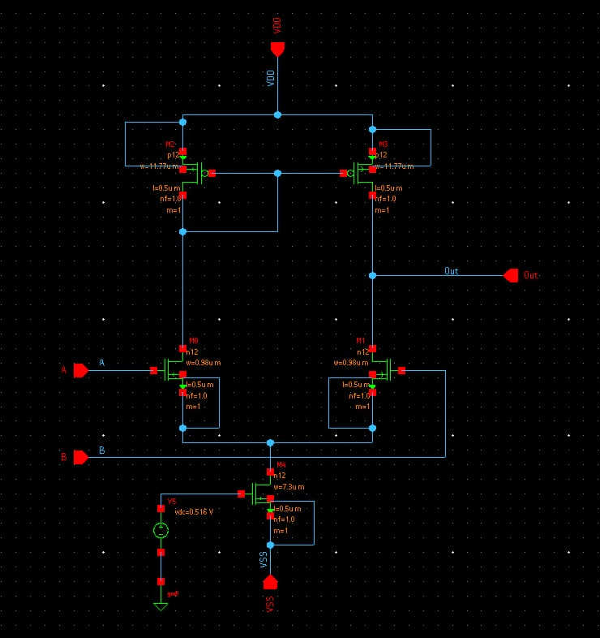
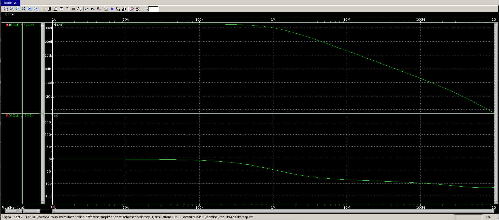
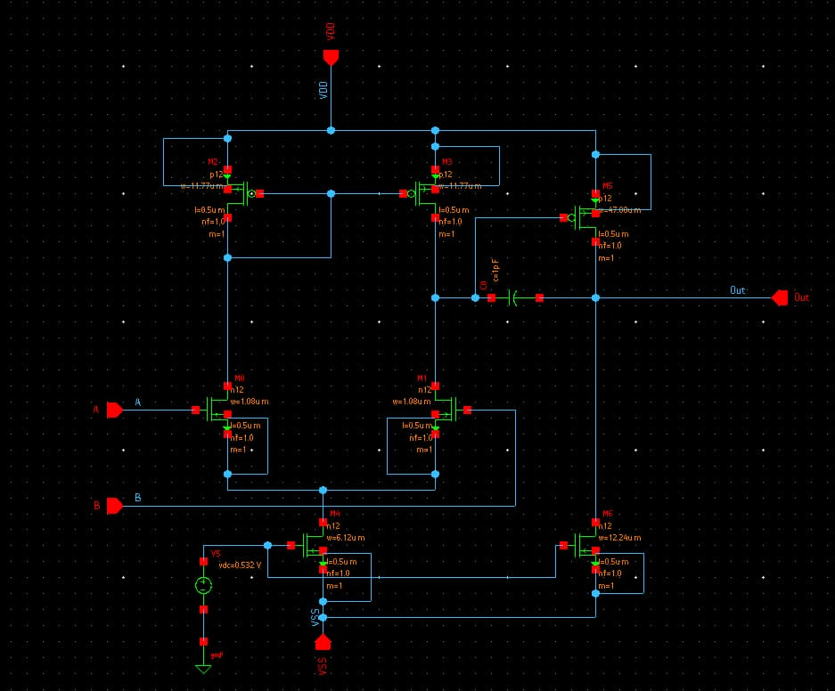
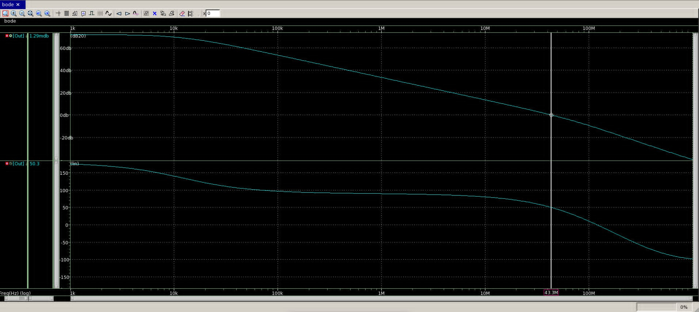
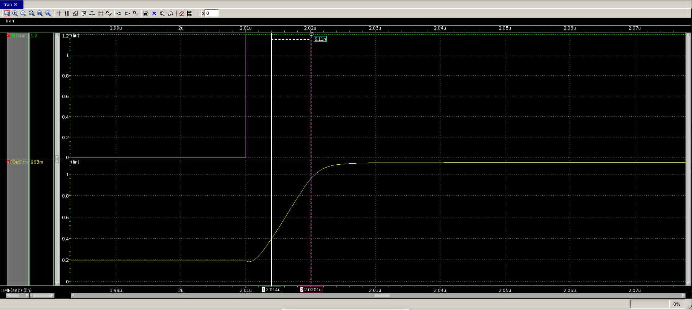
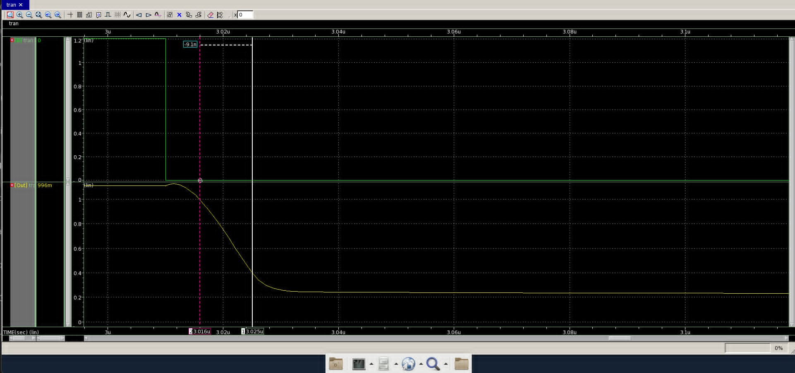
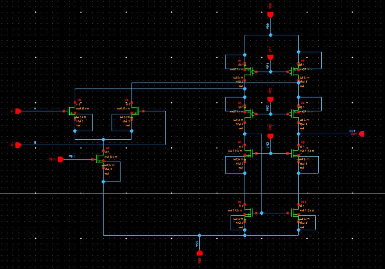
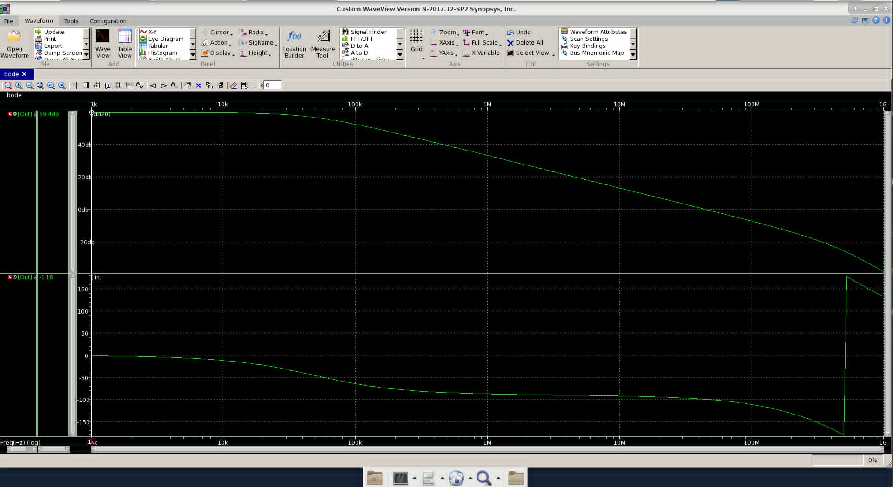

# CMOS Op-Amp Design in SAED 90 nm (1.2 V)

Three amplifiers designed from specification to simulation: hand sizing with the
P. E. Allen procedure, schematic entry in Synopsys Custom Compiler, and DC / AC /
transient characterization in HSPICE (waveforms in Custom WaveView).

| Design | Load | DC gain (sim.) | Unity-gain freq. (sim.) | Phase margin (sim.) |
|---|---|---|---|---|
| 5-T OTA, current-mirror load | 1 pF | 32.8 dB | 45.5 MHz | 87.6° |
| Two-stage Miller-compensated op-amp | 2 pF | 71.8 dB | 43.3 MHz | 50.3° |
| Folded-cascode op-amp, NMOS input | 2 pF | 59.4 dB | 44.4 MHz | 80.6° |

All transistors use L = 0.5 µm. Hand calculations use parameters extracted from the
BSIM4 models of the PDK:

| Parameter | NMOS | PMOS |
|---|---|---|
| K' = µC<sub>ox</sub> | 457.2 µA/V² | 63.8 µA/V² |
| V<sub>T0</sub> | 0.343 V | −0.235 V |
| λ | 0.0528 V⁻¹ | 0.0469 V⁻¹ |

## Contents

```
docs/
  hand_calc_5T_OTA_and_two_stage.pdf   step-by-step sizing of the 5-T OTA and the two-stage op-amp
  hand_calc_folded_cascode.pdf         nine-step sizing and bias voltages of the folded cascode
images/
  ota_5t/  two_stage/  folded_cascode/
    schematic.jpg                      Custom Compiler schematic with device sizes
    ac_dc_gain.jpg, ac_unity_gain.jpg  Bode plot; cursor at DC and at 0 dB
    op_point_1.jpg, op_point_2.jpg     HSPICE operating point of every MOSFET (gm, gds, Id, Vds, Vdsat, region)
    icmr_1.jpg, icmr_2.jpg             unity-gain follower, DC sweep of the input common-mode voltage
    output_swing_1.jpg, _2.jpg         open-loop DC transfer curve and its derivative
    slew_rate_up_*.jpg, _down_*.jpg    large-signal step response
```

PDK netlists and models are not included (the SAED 90 nm kit is distributed under a
Synopsys license).

---

## 1. 5-T OTA (current-mirror load)

**Specification:** SR ≥ 100 V/µs at C<sub>L</sub> = 1 pF, A<sub>v</sub> ≥ 60 V/V,
ICMR 0.85–1.05 V.

**Sizing.** I<sub>SS</sub> = SR·C<sub>L</sub> = 100 µA. The gain target sets
g<sub>m1</sub> = 299 µS, hence (W/L)<sub>1</sub> = 1.96. The upper ICMR limit sets the
PMOS load, (W/L)<sub>3</sub> = 23.5, and the lower limit sets the tail device,
(W/L)<sub>5</sub> = 14.6 with V<sub>bias</sub> = 0.516 V. Expected GBW = g<sub>m1</sub>/(2πC<sub>L</sub>) = 47.6 MHz.

| Device (schematic) | W (µm) |
|---|---|
| M0, M1 input pair | 0.98 |
| M2, M3 PMOS load | 11.77 |
| M4 tail | 7.30 |

The PDF also compares this ICMR-driven sizing with a first heuristic choice of overdrive
(tail W = 5.45 µm): the larger tail device lowers V<sub>DS(sat)</sub> and leaves headroom
for the input pair at the bottom of the common-mode range.

**Simulation.** Unity-gain frequency 45.5 MHz (hand estimate 47.6 MHz), phase margin 87.6°.
The DC gain is 32.8 dB (44 V/V), below the 60 V/V target: the operating point gives
g<sub>ds1</sub> + g<sub>ds3</sub> = 4.0 + 2.7 = 6.7 µS, whereas λI<sub>D</sub> predicts 5.0 µS,
and g<sub>m1</sub>/(g<sub>ds1</sub>+g<sub>ds3</sub>) = 295 µS / 6.7 µS = 44 V/V reproduces the simulated gain.

<p align="center"> </p>

## 2. Two-stage Miller-compensated op-amp

**Specification:** C<sub>L</sub> = 2 pF, SR ≥ 50 V/µs, GBW ≥ 50 MHz, PM ≈ 60°,
ICMR 0.85–1.05 V.

**Sizing.**
1. C<sub>c</sub> ≥ 0.22 C<sub>L</sub> → C<sub>c</sub> = 1 pF.
2. Tail current 100 µA (SR·C<sub>c</sub> = 50 µA is the minimum).
3. GBW = g<sub>m1</sub>/(2πC<sub>c</sub>) → g<sub>m1</sub> = 314 µS, W<sub>1,2</sub> = 1.08 µm.
4. Upper ICMR → W<sub>3,4</sub> = 11.77 µm; lower ICMR → W<sub>5</sub> = 6.12 µm, V<sub>bias</sub> = 0.532 V.
5. Second stage: p<sub>2</sub> ≥ 2.2·GBW requires g<sub>m6</sub> ≥ 1.38 mS; equal current
   density in M6 and M4 (zero systematic offset) then gives I<sub>D6</sub> = 200 µA,
   W<sub>6</sub> = 47.08 µm, and the mirrored sink W<sub>7</sub> = 12.24 µm.

Hand estimate: A<sub>v</sub> = 63.0 × 77.7 = 4895 V/V (73.8 dB), P = 360 µW,
output swing 0.19–0.94 V.

**Simulation.** DC gain 71.8 dB, unity-gain frequency 43.3 MHz, phase margin 50.3°,
slew rate +93 / −66 V/µs, all devices in saturation, supply current 309 µA (371 µW).
From the operating point,
(g<sub>m1</sub>/(g<sub>ds1</sub>+g<sub>ds3</sub>))·(g<sub>m6</sub>/(g<sub>ds6</sub>+g<sub>ds7</sub>)) = 45.7 × 86.0 ≈ 71.9 dB.

**Phase-margin shortfall (50.3° vs. 60°).** Two effects not in the first-order design:
- the right-half-plane zero at g<sub>m6</sub>/(2πC<sub>c</sub>) ≈ 247 MHz ≈ 4.9·GBW, about −11.5° at the unity-gain frequency;
- the current-mirror pole g<sub>m3</sub>/(2πC<sub>m</sub>) ≈ 98 MHz (C<sub>m</sub> ≈ 0.2 pF assumed), below 2·GBW.

A nulling resistor R<sub>z</sub> = (1/g<sub>m6</sub>)(1 + C<sub>L</sub>/C<sub>c</sub>) ≈ 1.93 kΩ in series with
C<sub>c</sub> would cancel the zero (derived, not yet simulated).

<p align="center"> </p>
<p align="center"> </p>

## 3. Folded-cascode op-amp (NMOS input)

**Specification:** C<sub>L</sub> = 2 pF, SR ≥ 50 V/µs, GB = 50 MHz, output swing 0.3–0.9 V,
ICMR 0.85–1.05 V, A<sub>v</sub> ≥ 5000 V/V.

**Sizing** follows the nine-step procedure of Allen (Lecture 24, Example 24-4):

| Device (schematic) | W/L | W (µm) | I<sub>D</sub> (µA) | Set by |
|---|---|---|---|---|
| M0, M1 input pair | 8.63 | 4.32 | 50 | GB |
| M2 tail | 3.61 | 1.81 | 100 | ICMR min |
| M3, M4 PMOS current sources | 174.1 | 87.1 | 125 | V<sub>out,max</sub> |
| M5, M6 PMOS cascodes | 174.1 | 87.1 | 75 | V<sub>out,max</sub> (worst case) |
| M7, M8 NMOS cascodes | 24.3 | 12.15 | 75 | V<sub>out,min</sub> (worst case) |
| M9, M10 NMOS mirror | 24.3 | 12.15 | 75 | V<sub>out,min</sub> |

Bias voltages for a wide-swing cascode: V<sub>N1</sub> = 0.691 V, V<sub>P1</sub> = 0.815 V,
V<sub>P2</sub> = 0.699 V, V<sub>N2</sub> = 0.575 V. Hand estimate of the gain: 85 dB; power 300 µW.

**Simulation.** DC gain 59.4 dB, unity-gain frequency 44.4 MHz, phase margin 80.6°,
supply current 242 µA (290 µW).

**Why the gain is 59 dB instead of 85 dB.** The operating point shows the top current
sources M3/M4 at V<sub>SD</sub> = 0.159 V against V<sub>SD(sat)</sub> = 0.137 V, and the bottom
mirror M9/M10 at V<sub>DS</sub> = 0.126 V against 0.098 V. Both sit at the edge of saturation,
so their output conductance is 107 µS and 71 µS instead of the λI<sub>D</sub> values of
about 6 µS and 4 µS used by hand. With the simulated g<sub>m</sub> and g<sub>ds</sub>:

- looking down: R<sub>down</sub> ≈ g<sub>m8</sub>/(g<sub>ds8</sub>g<sub>ds10</sub>) ≈ 3.1 MΩ;
- looking up: R<sub>up</sub> ≈ (g<sub>m6</sub>/g<sub>ds6</sub>)/(g<sub>ds4</sub>+g<sub>ds1</sub>) ≈ 2.8 MΩ;
- A<sub>v</sub> = g<sub>m1</sub>(R<sub>down</sub> ∥ R<sub>up</sub>) ≈ 637 µS × 1.48 MΩ ≈ 940 V/V ≈ 59.5 dB,

which matches the simulated 59.4 dB. Leaving more V<sub>DS</sub> margin on these four devices
(at the cost of output swing) is the next step to recover the gain.

<p align="center"> </p>

## References

- P. E. Allen and D. R. Holberg, *CMOS Analog Circuit Design*, 3rd ed., Oxford University Press, 2012.
- P. E. Allen, CMOS analog circuit design lecture notes, Lecture 24 (folded-cascode op-amp, Example 24-4).
- B. Razavi, *Design of Analog CMOS Integrated Circuits*, 2nd ed., McGraw-Hill, 2017.

## Author

Vu-Quoc-Minh Nguyen — Electronics and Telecommunications Engineering, University of Science, VNU-HCM.
